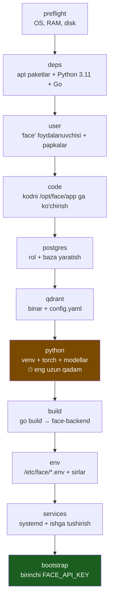

# Face servisni Docker'siz serverda ishga tushirish

> Bu qo'llanma face servisni **konteynersiz**, to'g'ridan-to'g'ri serverga
> (systemd bilan) o'rnatishni tushuntiradi.
>
> **Docker yo'li o'z joyida qoladi** — `docker compose up -d` avvalgidek ishlaydi.
> Ikkala rejim ham tayyor; faqat bir vaqtda ikkalasini ishlatib bo'lmaydi
> (portlar to'qnashadi — pastda "Rejimlar orasida almashish" bo'limiga qarang).

---

## 1. Nimadan boshlash kerak? — qisqa javob

```bash
cd face_detecting_microservice

# 1. Server talablarga mos keladimi — tekshiring (root kerak emas)
bash deploy/bare-metal/install.sh preflight

# 2. To'liq o'rnatish (20-40 daqiqa: torch ~900 MB, buffalo_l ~300 MB)
sudo bash deploy/bare-metal/install.sh

# 3. Birinchi API kalitni oling
sudo bash deploy/bare-metal/install.sh bootstrap
#    -> FACE_API_KEY=fdsk_...   ★ bu qiymat boshqa ko'rsatilmaydi, nusxalang

# 4. Holatni tekshiring
sudo bash deploy/bare-metal/install.sh status
```

Yoki Makefile orqali: `make bare-install` → `make bare-bootstrap` → `make bare-status`

**Keyingi qadam:** olingan `FACE_API_KEY` ni kirdi_chiqdi backendining `.env`
fayliga yozing — 8-bo'limga qarang.

---

## 2. Nima o'rnatiladi va qayerga

Docker'da 4 ta konteyner bor edi. Ularning har biri endi **alohida systemd
servisi** bo'ladi:

```
  DOCKER REJIMI                    DOCKER'SIZ REJIM
  ─────────────────                ────────────────────────────────
  qdrant       (konteyner)   →     qdrant.service        /opt/qdrant/qdrant
  ai-service   (konteyner)   →     face-ai.service       /opt/face/venv + uvicorn
  face-backend (konteyner)   →     face-backend.service  /opt/face/bin/face-backend
  face-postgres(konteyner)   →     postgresql.service    (tizim paketi)
```

### Fayllar joylashuvi

```
/opt/face/
├── app/                     ← manba kod nusxasi
│   ├── python-ai-service/
│   ├── golang-backend/      ← WEB_DIR shu yerdan olinadi (./web)
│   └── proto/
├── venv/                    ← Python virtual muhiti (torch, insightface…)
├── bin/face-backend         ← qurilgan Go binari
└── models/insightface/      ← buffalo_l (~300 MB)

/opt/qdrant/
├── qdrant                   ← binar
└── config/config.yaml       ← Qdrant o'z konfigini shu yerdan o'qiydi

/var/lib/qdrant/
├── storage/                 ← YUZ VEKTORLARI shu yerda — zaxira oling!
└── snapshots/

/etc/face/                   ← sozlamalar (chmod 640, egasi root:face)
├── qdrant.env
├── ai-service.env
└── face-backend.env         ← FACE_ID_PEPPER shu yerda — ZAXIRA OLING!

/etc/systemd/system/
├── qdrant.service
├── face-ai.service
└── face-backend.service
```

Servislar `face` nomli **tizim foydalanuvchisi** ostida ishlaydi — u login qila
olmaydi (`/usr/sbin/nologin`).

---

## 3. Talablar

| Narsa | Minimum | Tavsiya |
|---|---|---|
| OS | Ubuntu 22.04 / 24.04, Debian 12 | Ubuntu 24.04 LTS |
| Arxitektura | x86_64 yoki aarch64 | x86_64 |
| RAM | 4 GB | 8 GB |
| Disk | 6 GB bo'sh | 15 GB |
| **Python** | **3.11 yoki 3.12** | 3.11 |
| Go | 1.25+ | skript o'zi o'rnatadi |
| PostgreSQL | 14+ | 16 |

> ⚠️ **Python 3.13 ISHLAMAYDI.** `numpy==1.26.4`, `torch==2.4.1` va
> `onnxruntime==1.19.2` uchun 3.13 da tayyor wheel yo'q — pip manbadan qurishga
> urinadi va yiqiladi. Skript buni o'zi tekshiradi va kerak bo'lsa deadsnakes
> PPA orqali Python 3.11 o'rnatadi.

GPU ixtiyoriy. Kerak bo'lsa: NVIDIA drayver + `requirements-gpu.txt` va
`ai-service.env` da `DEVICE=cuda`.

---

## 4. O'rnatish qadamlari — batafsil

Skript **idempotent**: xohlagancha qayta ishga tushirsangiz mavjud narsalarni
buzmaydi. Har bir qadamni alohida ham bajarish mumkin.



### 4.1 `preflight` — tekshiruv

```bash
bash deploy/bare-metal/install.sh preflight
```
OS, arxitektura, RAM va bo'sh joyni tekshiradi. Hech narsani o'zgartirmaydi,
root ham kerak emas. **Har doim shu bilan boshlang.**

### 4.2 `deps` — tizim paketlari

```bash
sudo bash deploy/bare-metal/install.sh deps
```
- `build-essential`, `cmake` — insightface Cython bilan kompilyatsiya qilinadi
- `libgl1`, `libglib2.0-0` — opencv shularsiz import bo'lmaydi
- `postgresql`, `postgresql-client`
- Python 3.11/3.12 (yo'q bo'lsa deadsnakes PPA orqali)
- Go 1.25 (mavjud versiya eski bo'lsa go.dev dan tarball)

### 4.3 `user` + `code`

```bash
sudo bash deploy/bare-metal/install.sh user
sudo bash deploy/bare-metal/install.sh code
```
`face` foydalanuvchisini yaratadi va kodni `/opt/face/app` ga ko'chiradi.

> `genproto/` papkalari repoda **tayyor** — `protoc` yoki `grpcio-tools`
> o'rnatish shart emas. `.proto` ni o'zgartirsangizgina `make proto` kerak.

### 4.4 `postgres`

```bash
sudo bash deploy/bare-metal/install.sh postgres
```
`face` roli va `face_auth` bazasini yaratadi, tasodifiy parol yasaydi.
**Jadvallarni face-backend o'zi ishga tushganda yaratadi** — migratsiyalar
binar ichiga `go:embed` bilan kiritilgan, qo'lda SQL ishga tushirish kerak emas.

> Bu Postgres faqat **mijozlar, API kalitlar va audit jurnali** uchun.
> Yuz vektorlari Qdrant'da.

### 4.5 `qdrant`

```bash
sudo bash deploy/bare-metal/install.sh qdrant
```
GitHub'dan `v1.12.4` binarini va **o'sha versiyaning `config/config.yaml`**
faylini yuklaydi.

> ⚠️ Qdrant ish papkasidagi `config/config.yaml` ni o'qiydi. U bo'lmasa servis
> ishga tushmaydi. Shuning uchun uni faqat binar bilan cheklanib qoldirmaymiz.

### 4.6 `python` — eng uzun qadam

```bash
sudo bash deploy/bare-metal/install.sh python
```
1. `/opt/face/venv` yaratadi
2. `numpy` + `cython` ni **birinchi** o'rnatadi (insightface ularsiz qurilmaydi)
3. `requirements.txt` ni o'rnatadi (torch CPU wheel ~900 MB)
4. Anti-spoofing vaznlarini yuklaydi (`download_models.sh`)
5. `buffalo_l` ni oldindan yuklaydi (~300 MB) — birinchi so'rov tez bo'lsin uchun

Sekin internetda 20-40 daqiqa ketishi mumkin. Uzilib qolsa — shu buyruqni
qaytadan bering, allaqachon o'rnatilganlar o'tkazib yuboriladi.

### 4.7 `build`

```bash
sudo bash deploy/bare-metal/install.sh build
```
`CGO_ENABLED=0` bilan statik binar quradi → `/opt/face/bin/face-backend`.

### 4.8 `env` — sozlamalar va sirlar

```bash
sudo bash deploy/bare-metal/install.sh env
```

Bu qadam ikkita sirni hal qiladi:

| Sir | Xatti-harakat |
|---|---|
| `FACE_ID_PEPPER` | Allaqachon bo'lsa **hech qachon** qayta yozilmaydi. Bo'sh bo'lsa: avval Docker `.env` dan qidiradi (topilsa ko'chiradi — mavjud baza mos qoladi), topilmasa yangi yasaydi |
| `ADMIN_BOOTSTRAP_KEY` | Bo'sh bo'lsa yasaydi. `bootstrap` qadamidan keyin avtomatik o'chiriladi |

> 🔴 **`FACE_ID_PEPPER` ning zaxira nusxasini oling.** U `subject_id` (PNFL) ni
> HMAC-SHA256 qiladi va faqat natija saqlanadi. O'zgartirsangiz barcha
> `person_id` boshqa bo'ladi, mavjud yozuvlar "yo'qolgandek" ko'rinadi va butun
> bazani qayta to'ldirish kerak bo'ladi.

#### systemd env fayllari haqida muhim nuqta

`/etc/face/*.env` — bu **Docker `.env` emas**. systemd `EnvironmentFile`
qatorning oxirigacha hammasini qiymat deb oladi:

```ini
# ❌ XATO — qiymat "8000   # izoh" bo'lib qoladi
AI_PORT=8000   # Python HTTP

# ✅ TO'G'RI — izoh alohida qatorda
# Python HTTP porti
AI_PORT=8000
```

Shu sababli `deploy/bare-metal/env/*.example` fayllarida qator ichida izoh yo'q.
Tahrirlaganda shu qoidaga rioya qiling.

### 4.9 `services` — systemd

```bash
sudo bash deploy/bare-metal/install.sh services
```
Unit fayllarni o'rnatadi, avtoyuklashga qo'shadi va ishga tushiradi.

Ishga tushish tartibi muhim — `face-backend.service` da
`Requires=qdrant.service face-ai.service` yozilgan:

```
  postgresql ─┐
  qdrant ─────┼──► face-backend
  face-ai ────┘
```

> `face-ai` birinchi ishga tushganda modellarni xotiraga yuklaydi — sekin
> serverda 1-2 daqiqa. Shuning uchun `TimeoutStartSec=300`.

---

## 5. Birinchi API kalitni olish

```bash
sudo bash deploy/bare-metal/install.sh bootstrap
```

Skript avtomatik ravishda:
1. `kirdi_chiqdi` nomli mijozni ro'yxatga oladi
2. Unga `face:verify`, `face:register`, `face:read`, `face:delete` va
   `admin:keys` scope'lari bilan kalit beradi
3. Kalitni ekranga chiqaradi
4. `ADMIN_BOOTSTRAP_KEY` ni faylidan o'chiradi va servisni qayta ishga tushiradi

> ★ **`ADMIN_BOOTSTRAP_KEY` ni fayldan o'chirishdan oldin uni parol
> menejeringizga saqlang.** Skript uni xavfsizlik uchun o'chiradi, lekin
> VMS dagi kalit biror sababga ko'ra yo'qolsa (masalan `JWT_ACCESS_SECRET`
> almashtirilsa — u bazadagi shifrlangan kalitni ochadigan master sir ham),
> qaytishning yagona yo'li aynan shu qiymat bo'ladi. Uni qaytadan tiklab
> bo'lmaydi: `ADMIN_BOOTSTRAP_KEY` ni yangilash faqat bazada faol kalit
> qolmaganda ishlaydi.

```
══════════════════════════════════════════════════════════════
  FACE_API_KEY=fdsk_a1b2c3d4e5f6_xxxxxxxxxxxxxxxxxxxxxxxx
══════════════════════════════════════════════════════════════
```

> ★ **Bu qiymat boshqa ko'rsatilmaydi.** Darhol nusxalang. Yo'qotsangiz yangi
> kalit yaratish kerak bo'ladi (eski kalitni bekor qilib).

Qo'lda qilmoqchi bo'lsangiz — README dagi "Birinchi kalitni olish (bootstrap)"
bo'limidagi `curl` buyruqlari aynan shu ishni bajaradi.

---

## 6. Tekshirish

```bash
sudo bash deploy/bare-metal/install.sh status
```

Kutilgan natija:

```
  ✓ postgresql — ishlayapti
  ✓ qdrant — ishlayapti
  ✓ face-ai — ishlayapti
  ✓ face-backend — ishlayapti

  ✓ Qdrant    http://127.0.0.1:6333/healthz -> 200
  ✓ AI (HTTP) http://127.0.0.1:8000/health  -> 200
  ✓ Backend   http://127.0.0.1:8080/health  -> 200
```

Qo'lda:

```bash
curl -s http://127.0.0.1:8080/health | python3 -m json.tool
curl -s http://127.0.0.1:8000/health | python3 -m json.tool   # modellar holati
curl -s http://127.0.0.1:6333/healthz

# Anti-spoofing modeli haqiqatan ishlayaptimi
sudo -u face /opt/face/venv/bin/python \
     /opt/face/app/python-ai-service/scripts/verify_liveness.py
```

Loglar:

```bash
sudo journalctl -u face-backend -f
sudo journalctl -u face-ai -f
sudo journalctl -u qdrant -u face-ai -u face-backend -f   # uchalasi birga
```

---

## 7. Servislarni boshqarish

```bash
sudo systemctl status face-backend
sudo systemctl restart face-ai
sudo systemctl stop face-backend face-ai qdrant
sudo systemctl start qdrant face-ai face-backend

# Makefile qisqartmalari
make bare-status
make bare-logs
make bare-restart
make bare-stop
```

### Kodni yangilash

```bash
git pull
make bare-update          # code → build → restart → status
```

---

## 8. kirdi_chiqdi backendini ulash

Face servis tayyor bo'lgach, asosiy VMS backendiga uni ko'rsating.

### Ikkalasi bitta serverda

`kirdi_chiqdi_backend` ning `.env` fayliga:

```bash
FACE_API_BASE_URL=http://127.0.0.1:8080/api/v1
FACE_API_KEY=fdsk_...          # bootstrap bergan kalit
FACE_API_TIMEOUT=15s
FACE_ENROLL_ENABLED=true

# BO'SH QOLDIRING — brauzer liveness oqimiga VMS backendi orqali ulanadi
# (/api/v1/face/stream), face servis tashqariga umuman chiqarilmaydi.
FACE_STREAM_URL=
```

### Alohida serverlarda

Face servisni to'g'ridan-to'g'ri `0.0.0.0` ga chiqarmang. nginx + TLS orqali
oching va faqat VMS serverining IP siga ruxsat bering:

```nginx
server {
    listen 443 ssl;
    server_name face.internal.example.uz;

    ssl_certificate     /etc/letsencrypt/live/face.internal.example.uz/fullchain.pem;
    ssl_certificate_key /etc/letsencrypt/live/face.internal.example.uz/privkey.pem;

    # Faqat VMS serveri
    allow 10.0.0.15;
    deny  all;

    location / {
        proxy_pass http://127.0.0.1:8080;
        proxy_set_header Host              $host;
        proxy_set_header X-Real-IP         $remote_addr;
        proxy_set_header X-Forwarded-For   $proxy_add_x_forwarded_for;
        proxy_set_header X-Forwarded-Proto $scheme;

        # WebSocket oqimi (/api/v1/stream) uchun SHART
        proxy_http_version 1.1;
        proxy_set_header Upgrade    $http_upgrade;
        proxy_set_header Connection "upgrade";
        proxy_read_timeout 300s;
    }
}
```

So'ng VMS `.env` da: `FACE_API_BASE_URL=https://face.internal.example.uz/api/v1`

### Firewall

```bash
# Face servis portlari TASHQARIGA ochilmasin
sudo ufw deny 8080/tcp
sudo ufw deny 8000/tcp
sudo ufw deny 6333/tcp
sudo ufw deny 50051/tcp
```

Sozlama fayllarida ular allaqachon `127.0.0.1` ga bog'langan — ufw qo'shimcha
himoya qatlami.

---

## 9. Rejimlar orasida almashish

Ikkala rejim ham **bir xil portlarni** (8080, 6333, 5432) ishlatadi, shuning
uchun bir vaqtda ishlatib bo'lmaydi.

### Docker → Docker'siz

```bash
docker compose down                  # ma'lumot Docker volume'larida qoladi
sudo bash deploy/bare-metal/install.sh
```

> ⚠️ `install.sh env` mavjud `.env` dagi `FACE_ID_PEPPER` ni topsa **avtomatik
> ko'chiradi**. Lekin **yuz vektorlari ko'chirilmaydi** — ular Docker'dagi
> Qdrant volume'ida qoladi. Ma'lumotni saqlab qolish uchun 10-bo'limga qarang.

### Docker'siz → Docker

```bash
make bare-stop                       # yoki: sudo systemctl stop face-backend face-ai qdrant
sudo systemctl disable face-backend face-ai qdrant   # avtoyuklashdan olib tashlash
docker compose up -d
```

`.env` dagi `FACE_ID_PEPPER` `/etc/face/face-backend.env` dagi bilan **bir xil**
ekaniga ishonch hosil qiling.

---

## 10. Zaxira nusxa (backup)

Uchta narsa muhim:

```bash
# 1. FACE_ID_PEPPER — eng muhimi. Yo'qolsa butun baza yaroqsiz.
sudo grep FACE_ID_PEPPER /etc/face/face-backend.env

# 2. Yuz vektorlari — Qdrant snapshot
curl -X POST http://127.0.0.1:6333/collections/faces/snapshots
# Natija: /var/lib/qdrant/snapshots/faces/<nom>.snapshot

# 3. API kalitlar va audit bazasi
sudo -u postgres pg_dump face_auth | gzip > face_auth_$(date +%F).sql.gz
```

Qdrant ma'lumotini butunlay ko'chirish (masalan Docker'dan bare-metal'ga):

```bash
# Docker'dagi Qdrant'dan
docker compose up -d qdrant
curl -X POST http://127.0.0.1:6333/collections/faces/snapshots
docker cp face-qdrant:/qdrant/snapshots/faces/. ./qdrant-backup/

# Bare-metal Qdrant'ga
sudo cp ./qdrant-backup/*.snapshot /var/lib/qdrant/snapshots/faces/
curl -X PUT 'http://127.0.0.1:6333/collections/faces/snapshots/recover' \
  -H 'Content-Type: application/json' \
  -d '{"location":"file:///var/lib/qdrant/snapshots/faces/<nom>.snapshot"}'
```

---

## 11. Muammolarni bartaraf etish

| Belgi | Sabab va yechim |
|---|---|
| `face-ai` ishga tushmayapti, `ModuleNotFoundError: cv2` | `libgl1`/`libglib2.0-0` yo'q → `sudo bash install.sh deps` |
| `pip install` numpy/torch da yiqiladi | Python 3.13 ishlatilgan → 3.11 o'rnating, `venv` ni o'chirib `install.sh python` ni qayta bering |
| `qdrant` darhol o'chib qoladi | `config/config.yaml` yo'q → `sudo bash install.sh qdrant` |
| Qdrant har so'rovga `401` | `QDRANT__SERVICE__API_KEY=` **bo'sh qiymat** bilan yozilgan. Kerak bo'lmasa qatorni butunlay izohga oling |
| `face-backend` "FACE_ID_PEPPER majburiy" deb to'xtaydi | `/etc/face/face-backend.env` da bo'sh → `sudo bash install.sh env` |
| Env qiymatida izoh ham bor (`8000   # izoh`) | systemd inline izohni tushunmaydi → izohni alohida qatorga chiqaring |
| `face-backend` Qdrant'ga ulana olmayapti | `systemctl status qdrant`; `QDRANT_URL=http://127.0.0.1:6333` to'g'rimi |
| `bootstrap` "kalit allaqachon olingan" deydi | Bazada faol kalit bor. Yangisi kerak bo'lsa mavjud kalit bilan `/api/v1/admin/keys` ga murojaat qiling |
| Birinchi so'rov juda sekin | Modellar hali yuklanmoqda — `curl http://127.0.0.1:8000/health` bilan holatni ko'ring |
| `go build` xotira yetishmasligidan yiqiladi | Swap qo'shing yoki binarni boshqa mashinada qurib `/opt/face/bin/` ga ko'chiring |

Loglar hamma narsani aytadi:

```bash
sudo journalctl -u face-ai -n 100 --no-pager
sudo journalctl -u face-backend -n 100 --no-pager
```

---

## 12. Production'ga chiqishdan oldin

- [ ] `FACE_ID_PEPPER` ning zaxira nusxasi parollar menejerida
- [ ] `ADMIN_BOOTSTRAP_KEY` bo'sh (bootstrap'dan keyin avtomatik o'chadi)
- [ ] `CORS_ALLOW_ORIGIN` — `*` emas. Servisga faqat boshqa backend murojaat
      qilsa `none`; brauzer to'g'ridan-to'g'ri ulansagina aniq domen
- [ ] `LIVENESS_FAIL_CLOSED=true`
- [ ] `SWAGGER_ENABLED=false` (tashqi tarmoqqa ochiq bo'lsa)
- [ ] Qdrant `127.0.0.1` da; tashqariga chiqarilsa `QDRANT__SERVICE__API_KEY` yoqilgan
- [ ] ufw yoqilgan, 8080/8000/6333/50051 tashqaridan yopiq
- [ ] Qdrant snapshot va `pg_dump` uchun cron sozlangan
- [ ] `systemctl is-enabled qdrant face-ai face-backend` → uchalasi `enabled`
- [ ] Serverni qayta yuklab ko'ring: `sudo reboot`, keyin `make bare-status`

---

## 13. Buyruqlar shpargalkasi

```bash
# --- O'rnatish ---
bash deploy/bare-metal/install.sh preflight     # tekshiruv (root kerak emas)
sudo bash deploy/bare-metal/install.sh          # to'liq o'rnatish
sudo bash deploy/bare-metal/install.sh bootstrap# birinchi API kalit
sudo bash deploy/bare-metal/install.sh --help   # barcha qadamlar

# --- Kundalik ---
make bare-status      # holat + endpointlar
make bare-logs        # uchala servis logi
make bare-restart     # qayta ishga tushirish
make bare-update      # kodni yangilash va qayta yoyish
make bare-stop        # to'xtatish

# --- Docker rejimi (o'zgarmagan) ---
make setup && make up
make down
make logs
```
