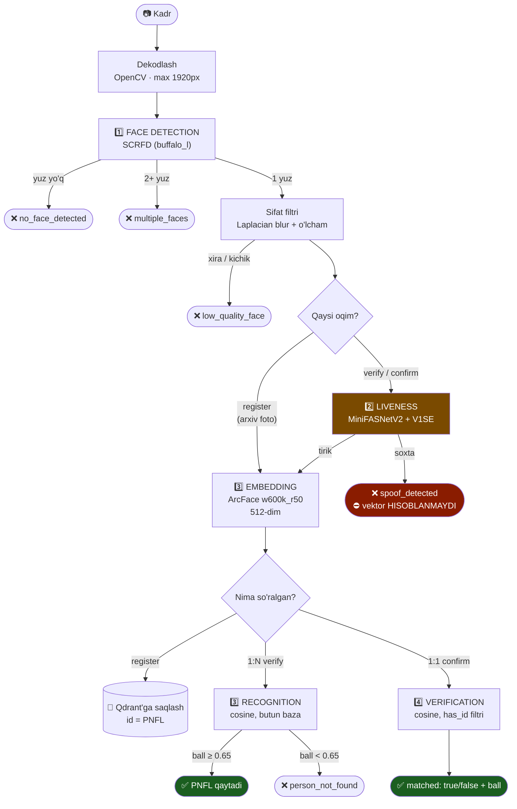

# Yuz texnologiyalari: nima bor va qanday modellar ishlatiladi

> Bu hujjat to'rtta imkoniyat — **Face Detection**, **Face Liveness Detection**,
> **Face Recognition** va **Face Verification** — dasturda haqiqatan borligini
> kod bilan tasdiqlaydi va har biri qaysi modelda ishlashini ko'rsatadi.

---

## 1. Qisqa javob

| # | Imkoniyat | Bormi | Model | Kod |
|---|-----------|:-----:|-------|-----|
| 1 | **Face Detection** | ✅ | **SCRFD** (buffalo_l tarkibida) | `insightface_adapter.py` |
| 2 | **Face Liveness Detection** (Anti-Spoofing) | ✅ | **MiniFASNetV2 + MiniFASNetV1SE** ansambli | `antispoofing/minifasnet_adapter.py` |
| 3 | **Face Recognition** (1:N — "bu kim?") | ✅ | **ArcFace w600k_r50** + Qdrant cosine | `usecase/verify.go` → `Verifier` |
| 4 | **Face Verification** (1:1 — "bu shu odammi?") | ✅ | O'sha ArcFace, bitta yozuv bilan | `usecase/verify.go` → `Confirmer` |

Bularga qo'shimcha ikkita yordamchi bosqich bor:

| Imkoniyat | Model / usul | Kod |
|---|---|---|
| Sifat filtri (blur, yuz o'lchami) | **Laplacian dispersiyasi** (OpenCV) | `imaging.py` → `LaplacianQualityInspector` |
| Real-time oqim | gRPC ikki tomonlama stream | `grpc_api.py` → `StreamFrames` |

---

## 2. Har biri batafsil

### 2.1 Face Detection — kadrda yuz bormi va qayerda?

**Model:** SCRFD (Sample and Computation Redistribution for Face Detection),
InsightFace'ning `buffalo_l` to'plami tarkibida, ONNX Runtime orqali ishlaydi.

```python
# python-ai-service/src/infrastructure/insightface_adapter.py
class InsightFaceDetector:
    """buffalo_l: SCRFD detektsiya + ArcFace (w600k_r50) 512-dim embedding."""

    app = FaceAnalysis(
        name=self._model_name,          # buffalo_l
        root=self._model_root,
        providers=self._device.providers,
        allowed_modules=["detection", "recognition"],
    )
    app.prepare(ctx_id=..., det_size=(self._det_size, self._det_size))
```

**Qoida:** kadrda **aynan bitta** yuz bo'lishi shart.

```python
# src/application/use_cases.py — ExtractFace
if not faces:
    raise NoFaceDetectedError("Rasmda yuz aniqlanmadi...")
if len(faces) > 1:
    raise MultipleFacesError(f"Rasmda {len(faces)} ta yuz aniqlandi...")
```

> Nima uchun bir nechta yuz rad etiladi? Autentifikatsiyada kadrda kim
> turganini aniq bilish shart. Aks holda orqada turgan begona odamning yuzi
> tanib olinishi mumkin.

**Sozlamalar:** `DET_SIZE` (640 = aniq, 320 = tez), `DET_SCORE_THRESHOLD=0.60`.

---

### 2.2 Face Liveness Detection — tirik odammi yoki surat?

**Model:** MiniFASNet ansambli (Silent-Face-Anti-Spoofing, MIT litsenziya),
PyTorch'da ishlaydi. Ikkita vazn fayli:

```
resources/anti_spoof_models/
├── 2.7_80x80_MiniFASNetV2.pth        ← scale 2.7, kirish 80×80
└── 4_0_0_80x80_MiniFASNetV1SE.pth    ← scale 4.0, kirish 80×80
```

Model nomi o'zi konfiguratsiya: `{scale}_{h}x{w}_{arxitektura}.pth`. Kod uni
regex bilan o'qiydi va yuzni shu `scale` bilan kesib modelga beradi.

**Har bir model 3 sinf ustidan softmax qaytaradi:**

```
[0] = spoof (print — bosma surat)
[1] = real  (tirik odam)
[2] = spoof (replay — ekrandagi video)
```

Ansambl natijalari o'rtachalanadi → yagona `real_probability`.

```python
# src/infrastructure/antispoofing/networks.py
MODEL_MAPPING = {
    "MiniFASNetV1":   MiniFASNetV1,
    "MiniFASNetV2":   MiniFASNetV2,
    "MiniFASNetV1SE": MiniFASNetV1SE,
    "MiniFASNetV2SE": MiniFASNetV2SE,
}
```

**Uchta muhim sozlama:**

| O'zgaruvchi | Ma'nosi |
|---|---|
| `LIVENESS_THRESHOLD=0.75` | Shu qiymatdan yuqori bo'lsa "tirik". 0.65 yumshoq, 0.85 qat'iy |
| `LIVENESS_REQUIRE_UNANIMOUS=true` | **Har ikkala** model "real" deyishi shart — soxta yuzni o'tkazib yuborish ehtimoli keskin pasayadi |
| `LIVENESS_FAIL_CLOSED=true` | Model yuklanmasa so'rov **rad etiladi**. Production'da albatta `true` |

**Eng muhim xavfsizlik qoidasi** — soxta kadrda vektor umuman hisoblanmaydi:

```python
# src/application/use_cases.py — VerifyFrame
def execute(self, image):
    face = self._extract.execute(image)
    result = self._liveness.execute(image, face)   # STEP 1 — spoof bo'lsa shu yerda to'xtaydi
    return FaceAnalysis(face=face, liveness=result) # STEP 2
```

Bu qoida testda qulflangan:

```go
// internal/usecase/verify_test.go
func TestVerifyStopsAtSpoofAndNeverSearches(t *testing.T) {
    ...
    if n := repo.searchCalls.Load(); n != 0 {
        t.Fatalf("SPOOF holatida %d ta qidiruv bajarildi — 0 bo'lishi SHART!", n)
    }
}
```

---

### 2.3 Face Recognition (1:N) — "bu kim?"

**Model:** ArcFace `w600k_r50` (ResNet-50 asosidagi), buffalo_l tarkibida.
Chiqish: **512 o'lchamli** normallashtirilgan vektor (embedding).

**Qidiruv:** Qdrant, **cosine similarity**.

```go
// internal/usecase/verify.go — Verifier.Execute
//   STEP 1  Liveness (Anti-Spoofing)
//   STEP 2  Embedding — faqat tirik inson tasdiqlangandan keyin
//   STEP 3  Vektor qidiruv — cosine ball chegaradan o'tishi kerak

matches, err := v.repo.FindNearest(ctx, face.Embedding, searchCandidates)
if len(matches) == 0 || !v.threshold.Accepts(matches[0].Score) {
    return nil, domain.NewError(domain.CodePersonNotFound, "Bazadan inson topilmadi.")
}
```

**Endpoint:** `POST /api/v1/persons/verify` (rasm → PNFL)

**Chegara:** `MATCH_THRESHOLD=0.65` (0.50 yumshoq · 0.65 muvozanatli · 0.75+ qat'iy)

> `searchCandidates = 3` — birinchisi qaror uchun, qolgan ikkitasi diagnostika
> uchun. Ikkinchi o'rindagi ball birinchisiga juda yaqin bo'lsa, bu chegara
> past qo'yilganini bildiradi.

---

### 2.4 Face Verification (1:1) — "bu odam haqiqatan shu odammi?"

**Model:** o'sha ArcFace, lekin qidiruv **bitta yozuv** bilan cheklanadi.

**Endpoint:** `POST /api/v1/persons/{person_id}/verify` (PNFL + rasm → ha/yo'q + ball)

```go
// internal/usecase/verify.go — Confirmer.Execute
match, found, err := c.repo.ScoreAgainst(ctx, face.Embedding, personID)
...
matched := c.threshold.Accepts(match.Score)
```

**Chegara:** `CONFIRM_THRESHOLD` — sozlanmagan bo'lsa `MATCH_THRESHOLD - 0.10`.

Standart qiymat aniq son emas, **ayirma**: 1:1 har doim 1:N dan yumshoqroq
bo'lishi kerak, `MATCH_THRESHOLD` qanday qo'yilganidan qat'i nazar. Aniq son
(masalan 0.55) faqat bitta sozlamada to'g'ri bo'lardi — `MATCH_THRESHOLD=0.50`
da u qattiqroq bo'lib qolardi va butun mantiq teskarisiga aylanardi.

> **Nima uchun ikki xil chegara.** Ikkalasi bir xil cosine ballni o'lchaydi,
> lekin boshqa xavfni boshqaradi:
>
> - **1:N** — nomzod butun baza. Chegara pasaysa, HAR BIR begona yozuv
>   tasodifan birinchi o'ringa chiqish imkoniga ega bo'ladi, va bu ehtimol
>   baza kattalashgani sari ortadi. Qattiqlik bu yerda xavfsizlikni oshiradi.
> - **1:1** — nomzod bitta, va u chaqiruvchi tomonidan HUJJATDAN olingan.
>   Begona bilan chalkashish xavfi yo'q. Qattiq chegara bu yerda faqat bitta
>   narsani beradi: haqiqiy odamni rad etish (false reject) — masalan arxiv
>   fotosi 5-10 yillik bo'lgani uchun.
>
> Sozlanmagan bo'lsa `MATCH_THRESHOLD` ishlatiladi (eski xatti-harakat).

Qdrant tomonida bu `has_id` filtri bilan bajariladi:

```go
// internal/adapter/vectordb/qdrant.go — ScoreAgainst
"filter": map[string]any{
    "must": []map[string]any{
        {"has_id": []string{PointIDFor(personID)}},
    },
},
```

**Nima uchun 1:N yetarli emas:**

| | 1:N (Recognition) | 1:1 (Verification) |
|---|---|---|
| Savol | "Bu kim?" | "Bu shu odammi?" |
| Nomzodlar | Butun baza | Aynan bitta |
| Baza kattalashsa | Begona odam tasodifan chegaradan o'tishi ehtimoli **ortadi** | O'zgarmaydi |
| "Topilmadi" | Xato (404) | Javob (`matched: false`, 200) |
| Qachon ishlatiladi | Kim kelganini bilmasak | Chek/PNFL allaqachon ma'lum |

> Chiqishda chekni tasdiqlashda 1:N ortiqcha ish **va** ortiqcha xavf: PNFL
> allaqachon ma'lum bo'lgani uchun butun bazani titkilashning hojati yo'q.

---

## 3. To'liq oqim — bir rasmning yo'li



---

## 4. Modellar jadvali — texnik tafsilotlar

| Model | Vazifasi | Arxitektura | Kirish | Chiqish | Runtime | Hajmi |
|---|---|---|---|---|---|---|
| **SCRFD** | Detection | Anchor-free CNN | 640×640 (sozlanadi) | bbox + 5 nuqta + ball | ONNX Runtime | buffalo_l tarkibida |
| **ArcFace w600k_r50** | Recognition / Verification | ResNet-50 | 112×112 (kesilgan yuz) | 512-dim vektor | ONNX Runtime | ~166 MB |
| **MiniFASNetV2** | Liveness | MobileFaceNet + DepthWise | 80×80 (scale 2.7) | 3 sinf softmax | PyTorch | ~1.8 MB |
| **MiniFASNetV1SE** | Liveness | + Squeeze-Excitation | 80×80 (scale 4.0) | 3 sinf softmax | PyTorch | ~1.8 MB |
| **Laplacian** | Sifat filtri | — (klassik CV) | kesilgan yuz | dispersiya | OpenCV | — |

**buffalo_l to'plami:** ~300 MB, birinchi ishga tushishda avtomatik yuklanadi
(`INSIGHTFACE_ROOT` ga).

**Manbalar:**
- InsightFace / buffalo_l — https://github.com/deepinsight/insightface
- Silent-Face-Anti-Spoofing (MiniFASNet) — https://github.com/minivision-ai/Silent-Face-Anti-Spoofing (MIT)

---

## 5. O'zingiz tekshiring

### 5.1 Modellar yuklanganmi

```bash
curl -s http://127.0.0.1:8000/health | python3 -m json.tool
```

### 5.2 Anti-spoofing haqiqatan ishlayaptimi

```bash
# Docker'da
docker compose exec ai-service python scripts/verify_liveness.py

# Docker'siz
sudo -u face /opt/face/venv/bin/python \
     /opt/face/app/python-ai-service/scripts/verify_liveness.py
```

### 5.3 To'rtta imkoniyatni qo'lda sinash

```bash
KEY="fdsk_..."
BASE="http://127.0.0.1:8080/api/v1"

# 1) DETECTION + 3) RECOGNITION uchun bazaga qo'shish
curl -X POST $BASE/persons/register -H "X-API-Key: $KEY" \
     -F "subject_id=12345678901234" -F "name=Karimov A." -F "image=@foto.jpg"

# 2) LIVENESS — faqat tiriklik (probe)
curl -X POST $BASE/liveness/check -H "X-API-Key: $KEY" -F "image=@kadr.jpg"

# 3) RECOGNITION (1:N) — "bu kim?"
curl -X POST $BASE/persons/verify -H "X-API-Key: $KEY" -F "image=@kadr.jpg"

# 4) VERIFICATION (1:1) — "bu shu odammi?"
curl -X POST $BASE/persons/12345678901234/verify -H "X-API-Key: $KEY" \
     -F "image=@kadr.jpg"
```

**Soxtani sinash:** telefon ekranidagi suratni kameraga tuting —
`400 spoof_detected` qaytishi kerak.

### 5.4 Testlar bilan

```bash
cd golang-backend && go test ./... -v -run 'Spoof|Confirm|Verify'
```

Kutilgan natijaning eng muhim qatorlari:

```
--- PASS: TestVerifyStopsAtSpoofAndNeverSearches
--- PASS: TestMatchEmbeddingRejectsNonLiveFrame
--- PASS: TestConfirmStopsAtSpoofAndNeverSearches
--- PASS: TestConfirmOnlyComparesAgainstRequestedPerson
```

---

## 6. Aniqlik va tezlik

| Bosqich | CPU (taxminan) | GPU |
|---|---|---|
| Detection (640×640) | 60–120 ms | 8–15 ms |
| Liveness (2 model, 80×80) | 8–15 ms | 3–5 ms |
| Embedding (ArcFace) | 25–50 ms | 5–8 ms |
| Qdrant qidiruv (100k yozuv) | 2–8 ms | — |

> **Eng katta tor joy — detektsiya.** `DET_SIZE` ni 640 dan 320 ga tushirish
> real-time oqimni sezilarli tezlashtiradi. Kiosk/webcam uchun (yuz yaqin
> bo'lganda) 320 yetarli aniqlik beradi.

GPU rejimi: `DEVICE=cuda` + `requirements-gpu.txt`.
